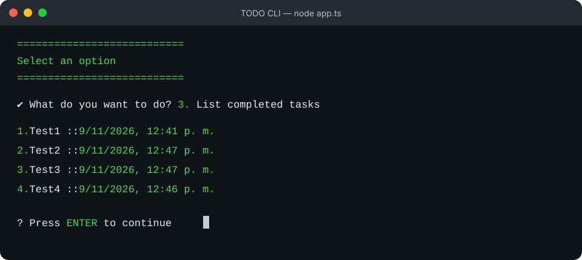

# TODO CLI

A terminal application for managing tasks with TypeScript, Inquirer, and local JSON persistence.



## Features

- Create tasks with a required description.
- List all tasks and their status (`Completed` or `Pending`).
- Filter completed and pending tasks.
- Mark multiple tasks using a `checkbox` selector.
- Delete a task after confirmation.
- Automatically save changes to `tasks.json`.
- Display dates in Spanish using the `America/Bogota` time zone.

## Requirements

- Node.js 24 or later.
- npm.

## Installation and usage

```bash
npm install
npm run dev
```

Use the arrow keys to navigate the menu and press `Enter` to confirm:

```text
1. Create task
2. List tasks
3. List completed tasks
4. List pending tasks
5. Complete task(s)
6. Delete task
0. Exit
```

## Persistence

On startup, the application reads `tasks.json`. After each operation, it saves the complete task array again:

```json
{
  "id": "uuid",
  "description": "Learn TypeScript",
  "completedAt": "2026-11-09T17:41:28.733Z"
}
```

`completedAt` is `null` while the task is pending. Once completed, it stores an ISO date in UTC. For display, the application converts the value to `Date` and uses `Intl.DateTimeFormat`:

```ts
const formattedDate = new Intl.DateTimeFormat("es-CO", {
  dateStyle: "medium",
  timeStyle: "short",
  timeZone: "America/Bogota",
}).format(new Date(completedAt));
```

Therefore, `2026-11-09T17:41:28.733Z` is displayed as `9/11/2026, 12:41 p. m.` in Bogotá.

## Project structure

```text
.
├── app.ts                 # Main loop and menu actions
├── helpers/
│   ├── inquirer.ts        # Menus, inputs, and confirmations
│   └── saveFile.ts        # Reads and writes tasks.json
├── models/
│   ├── task.ts            # Task model
│   └── tasks.ts           # Task collection and operations
└── tasks.json             # Data generated at runtime
```

## Technologies

- `inquirer`: interactive terminal interface.
- `colors`: colors for statuses and options.
- `uuid`: unique identifiers.
- `Intl.DateTimeFormat`: date formatting without additional dependencies.

